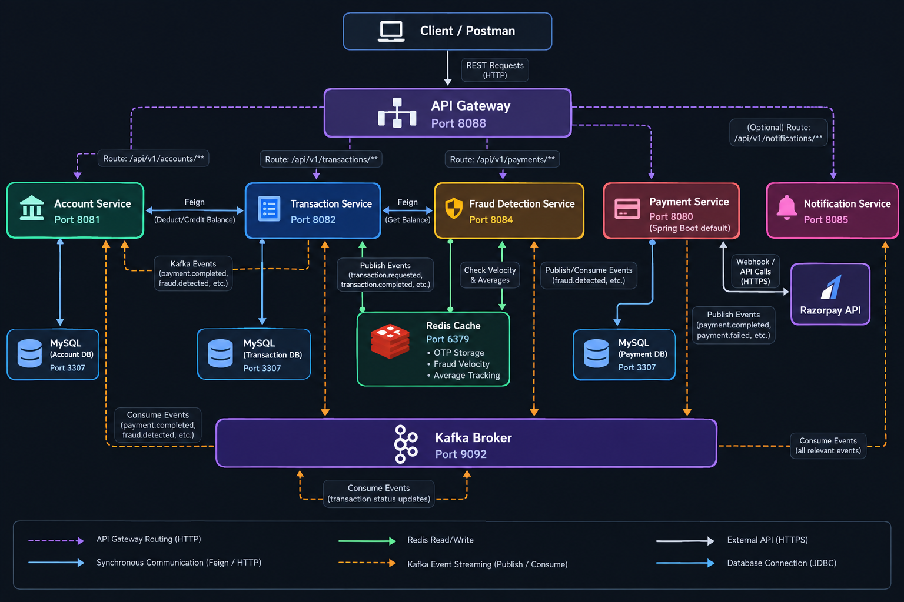

# Premium Distributed Banking System (Microservices)

A high-performance, secure, and event-driven distributed banking system built using **Spring Boot**, **Spring Cloud Gateway**, **Apache Kafka**, **Redis**, and **MySQL**. It features a robust **SAGA Orchestration Pattern** for money transfers, real-time **Fraud Detection**, rate limiting, asynchronous event notifications, and a third-party payment gateway integration with **Razorpay**.

---

## 1. High-Level Architecture (HLD)

The system is designed as a set of decentralized microservices communicating both synchronously (via Spring Cloud OpenFeign for transactional queries) and asynchronously (via Apache Kafka for event-driven updates).





### Key Architectural Concepts
1. **API Gateway (Spring Cloud Gateway)**: Serves as the single entry point. Protects backend services by implementing IP-based request rate limiting via Redis.
2. **SAGA Orchestration Pattern**: Orchestrates money transfers. Instead of using complex distributed transactions (2PC), the Transaction Service controls the steps and executes compensating transactions (refunds) if verification fails.
3. **Event-Driven Choreography**: Critical alerts, block triggers, deposit credits, and notification dispatches are routed asynchronously through Kafka topics.
4. **Real-time Fraud Analysis**: Evaluates transaction risk by analyzing transaction velocity (Redis counters), transaction averages, and percentage of account balance consumed.

---

## 2. Low-Level Design (LLD) & Microservices Breakdown

### 1. API Gateway (`api-gateway` - Port `8088`)
* **Technology**: Spring Cloud Gateway MVC, Redis Rate Limiter.
* **Key Responsibilities**:
  * Routes traffic to appropriate service instances based on path prefixes.
  * Limits request rates per client IP (`KeyResolver`) using Redis to prevent DDoS and API abuse.

### 2. Account Service (`account-service` - Port `8081`)
* **Technology**: Spring Boot Web, Spring Data JPA, MySQL.
* **Key Responsibilities**:
  * Creates and manages account details (type, status, owner data).
  * Performs synchronous balance adjustments (`deductBalance` / `creditBalance`).
  * Listens to Kafka topics:
    * `payment.completed`: Credits balance upon successful deposit.
    * `fraud.detected`: Blocks compromised accounts (sets status to `BLOCKED`).

### 3. Transaction Service (`transaction-service` - Port `8082`)
* **Technology**: Spring Boot Web, Spring Cloud OpenFeign, Redis, Spring Data JPA, MySQL.
* **Key Responsibilities**:
  * Initiates peer-to-peer transfers.
  * Manages transfer states (`PROCESSING`, `PENDING_VERIFICATION`, `COMPLETED`, `FLAGGED`).
  * Generates 6-digit OTP verification codes and stores them in Redis with a 5-minute TTL.
  * Implements SAGA rollback logic (`compensateTransaction`) if the transfer fails validation or verification.

### 4. Payment Service (`payment-service` - Port `8080`, Spring Boot default)
* **Technology**: Razorpay SDK, MySQL, Kafka, Spring Boot Web.
* **Key Responsibilities**:
  * Requests Razorpay order creations.
  * Exposes webhook endpoints for Razorpay payment callback verification.
  * Publishes `payment.completed` or `payment.failed` events to Kafka.

### 5. Fraud Detection Service (`fraud-detection-service` - Port `8084`)
* **Technology**: Spring Data Redis, Spring Cloud OpenFeign, Kafka.
* **Key Responsibilities**:
  * Consumes `transaction.initiated`.
  * Runs real-time validation checks:
    * **Velocity Rule**: Flags accounts with high transaction frequencies in under 60 seconds.
    * **Amount Rule**: Flags amounts exceeding 3x the account's historical average.
    * **Balance Rule**: Flags transactions using > 90% of the sender's current balance.
  * Publishes `fraud.check.clean` (if safe) or `verification.required` (if suspicious).

### 6. Notification Service (`notification-service` - Port `8085`)
* **Technology**: Spring Kafka.
* **Key Responsibilities**:
  * Listens to Kafka topics (`transaction.completed`, `fraud.detected`, `transaction.otp.generated`, `transaction.refunded`, `payment.completed`).
  * Prints system notification cards and triggers alerts to users.

---

## 3. Core System Workflows

### A. Money Transfer Flow (SAGA with OTP Verification)

```
[Sender]              [Transaction-Service]          [Fraud-Service]           [Redis / Account]
   │                           │                            │                          │
   │─── 1. POST /transfer ────>│                            │                          │
   │                           │─── 2. Deduct Balance (Sync)──────────────────────────>│ [Deducted]
   │                           │─── 3. Save as PROCESSING ──│                          │
   │                           │─── 4. Publish Event ──────>│                          │
   │                           │                            │─── 5. Evaluate Rules ───>│ (Checks Avg,
   │                           │                            │                          │  Velocity, %)
   │                           │                            │                          │
   │                           │<── 6. Flagged Suspect ─────│                          │
   │                           │    (verification.required) │                          │
   │                           │─── 7. Gen OTP & Save ────────────────────────────────>│ (TTL: 5m)
   │                           │─── 8. Publish OTP Event ──> [Notification Service]    │
   │                           │                            │                          │
   │─── 9. POST /verify ──────>│                            │                          │
   │   (Validates OTP)         │─── 10. OTP matches ────────│                          │
   │                           │─── 11. Credit Recipient (Sync)───────────────────────>│ [Credited]
   │                           │─── 12. Save COMPLETED ─────│                          │
   │                           │─── 13. Publish Completed ──> [Notification Service]    │
```

*In case of **Incorrect OTP / Timeout**:*
1. Transaction Service triggers `compensateTransaction()`.
2. Synchronously credits the deducted amount back to the Sender.
3. Publishes `fraud.detected` to block the sender's account.
4. Updates transaction status to `FLAGGED` with failure details.

### B. Payment Deposit Flow (Razorpay Webhook)
1. **Order Creation**: Client posts to `/api/v1/payments/create-order`. The Payment Service contacts the Razorpay API, generates an order token, and saves the transaction status as `CREATED`.
2. **Payment Callback**: The user pays on the frontend interface. Razorpay sends an HTTP webhook POST to `/api/v1/payments/webhook`.
3. **Verification**: Payment Service verifies the webhook signature.
   * **Successful Capture**: Changes payment state to `COMPLETED` and publishes `payment.completed` to Kafka.
   * **Failure**: Changes state to `FAILED` and publishes `payment.failed`.
4. **Balance Integration**: Account Service consumes `payment.completed` and automatically updates the database to credit the deposited funds.

---

## 4. API Documentation & Payloads

### 1. Create Account
* **Endpoint**: `POST http://localhost:8081/api/v1/accounts`
* **Request Body**:
```json
{
  "accountHolderName": "John Doe",
  "email": "johndoe@example.com",
  "phone": "9876543210",
  "accountType": "SAVINGS",
  "initialDeposit": 1000.00
}
```
* **Response Body**:
```json
{
  "id": "00f4c64c-e3d2-4f84-972a-587d65898820",
  "accountNumber": "624694969355",
  "accountHolderName": "John Doe",
  "email": "johndoe@example.com",
  "phone": "9876543210",
  "accountType": "SAVINGS",
  "status": "ACTIVE",
  "balance": 1000.00,
  "dailyTransactionLimit": 100000
}
```

### 2. Initiate Transfer
* **Endpoint**: `POST http://localhost:8082/api/v1/transactions/transfer`
* **Request Body**:
```json
{
  "senderAccountNumber": "624694969355",
  "receiverAccountNumber": "440567752918",
  "amount": 200.00,
  "description": "Lunch split"
}
```
* **Response Body**:
```json
{
  "id": "e939923c-4fed-4b24-a55a-0e47411f5317",
  "senderAccountNumber": "624694969355",
  "receiverAccountNumber": "440567752918",
  "amount": 200.00,
  "type": "TRANSFER",
  "status": "PROCESSING",
  "description": "Lunch split",
  "referenceNumber": "3835e9b4-3387-4627-b54b-c8a1ec0f270c"
}
```

### 3. Verify OTP
* **Endpoint**: `POST http://localhost:8082/api/v1/transactions/{transactionId}/verify-otp?otp={otp}`
* **Response Body**:
```json
{
  "id": "bd2e8e57-d605-4c99-bb11-70c5d59e2e7d",
  "senderAccountNumber": "624694969355",
  "receiverAccountNumber": "440567752918",
  "amount": 2100.00,
  "type": "TRANSFER",
  "status": "COMPLETED",
  "description": "High Value Split"
}
```

### 4. Mock Payment Deposit Webhook (Local Testing)
* **Endpoint**: `POST http://localhost:8080/api/v1/payments/webhook`
* **Request Body**:
```json
{
  "event": "payment.capture",
  "payload": {
    "payment": {
      "entity": {
        "id": "pay_dummy456",
        "order_id": "order_dummy123"
      }
    }
  }
}
```

---

## 5. Setup and Run Instructions

### Prerequisites
* Java 21 SDK
* Maven 3.8+
* Docker & Docker Compose

### Step 1: Spin up Infrastructure
Run the Docker Compose file to start Kafka, Zookeeper, Redis, and MySQL:
```bash
docker compose up -d
```
*Infrastructure host ports: MySQL **`3307`**, Redis **`6379`**, and Kafka **`9092`**. The Transaction Service configuration currently uses Kafka port **`29092`**; this is the Docker-network listener, whereas local host processes should use **`9092`**.*

### Step 2: Run the Services
Run each Maven module independently or import them into your preferred IDE and launch the main application classes in this order:
1. `api-gateway` (Port `8088`)
2. `account-service` (Port `8081`)
3. `transaction-service` (Port `8082`)
4. `fraud-detection-service` (Port `8084`)
5. `payment-service` (Port `8080`, Spring Boot default; no explicit `server.port` is configured)
6. `notification-service` (Port `8085`)
